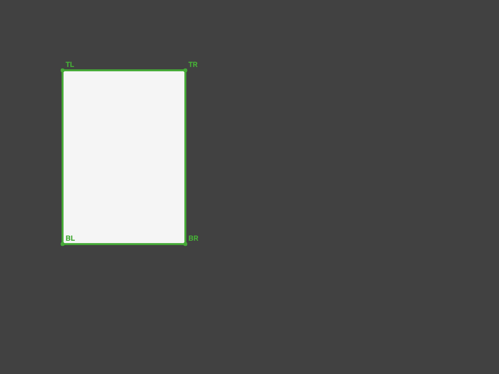

# A4 Paper Detector

Detect the four corners of an A4 sheet in a photograph using OpenCV and NumPy.
The package includes paper-boundary recovery, reference validation, and a
homography helper for mapping image coordinates onto the paper plane.

Extracted from a foot-measurement application. Runs locally on a CPU with no
model downloads, API keys, or network calls during detection.

## Installation

Requires Python 3.11 or newer.

```bash
python -m pip install "git+https://github.com/Aubnsh22/a4-paper-detector.git@v0.1.0"
```

Alternatively, download or clone the repository and install it locally:

```bash
git clone https://github.com/Aubnsh22/a4-paper-detector.git
cd a4-paper-detector
python -m pip install .
```

Use a virtual environment if your application has its own dependencies. The
package installs `opencv-python-headless`; do not install another OpenCV wheel
alongside it in the same environment, as they provide the same `cv2` module.

## Python usage

```python
import cv2
from a4_detector import detect_a4

image = cv2.imread("photo.jpg")  # uint8 BGR, shape (height, width, 3)
if image is None:
    raise ValueError("Could not read photo.jpg")

result = detect_a4(image)

if result.valid:
    corners = result.corners  # (4, 2): top-left, top-right, bottom-right, bottom-left
    print(corners)
else:
    print(result.messages)

payload = result.to_dict()  # JSON-compatible, including rejection reasons
```

Coordinates refer to the input image, in pixels. `result.corners` is `None`
when the reference is rejected. `result.confidence` is a ranking score, not
a probability that the detection is correct.

Convert RGB images to BGR before detection. Decode and orient the image once,
then use that same image for detection, overlays, and downstream processing.

## Command line

From a clone of the repository:

```bash
python examples/detect_image.py
a4-detect examples/images/synthetic_a4.png --output outputs/result.json --overlay outputs/overlay.png
```

`python -m a4_detector` accepts the same arguments as `a4-detect`.
Without `--output`, the result is printed as JSON. The exit code is `0` for an
accepted reference, `1` for a rejected reference, and `2` for an input or output
error. CLI image formats depend on the installed OpenCV codecs; JPEG and PNG
are the recommended inputs. HEIC is not decoded by this package.

The example below is synthetic. Its known rectangle is used to check corner
localization, not to demonstrate real-camera accuracy.



## Integration

Use `detect_a4()` for the reference acceptance rules from the original
application. It includes four visible corners, image and paper size limits,
boundary diagnostics, and an assumed-focal pose check.

For applications that need the detector without those acceptance rules:

```python
from a4_detector import detect_a4_paper

detection = detect_a4_paper(image, collect_debug=True)
print(detection.success, detection.corners, detection.message)
```

The core detector can accept cases that `detect_a4()` rejects, including a
reconstructed fourth corner or stronger perspective. Core `success` alone
does not mean the reference is suitable for measurement.

The core implementation is also available as a single file:
[`src/a4_detector/a4_detection.py`](src/a4_detector/a4_detection.py). It can be
copied into a Python project with OpenCV and NumPy installed. Keep the MIT
license with redistributed code. Copying this file alone does not include
the additional validation and colour-boundary recovery.

See [Integration](docs/INTEGRATION.md) for the result schema, homography usage,
and validation thresholds, and [Algorithm](docs/ALGORITHM.md) for the detection
steps and source extraction details.

## Limits

The sheet must actually be A4, **210 x 297 mm**, flat, and on the reference
plane. A photograph cannot establish physical paper size. A3 and A5 have the
same proportions, and other rectangles can resemble paper.

Pale or patterned floors, shadows, glare, blur, folds, occlusion, and strong
perspective can cause missed or incorrect detections. Corner and confidence
diagnostics are engineering heuristics, not calibrated uncertainty estimates.
Test on images from the cameras and capture conditions used by your application.

This package detects the paper reference. It does not detect feet, choose
heel/toe points, or establish the accuracy of a foot measurement.

## Development

```bash
python -m pip install -e ".[dev]"
python -m pytest -q
python -m build
```

Tests cover synthetic paper geometry, patterned backgrounds, ambiguity,
colour-boundary recovery, acceptance rules, coordinate mapping, and CLI
outputs. No private capture images are required. GitHub Actions tests the
package on Linux and Windows and checks installation from a built wheel.

See [Contributing](CONTRIBUTING.md) for changes and regression tests.

## License

[MIT](LICENSE). OpenCV and NumPy retain their respective licenses.
